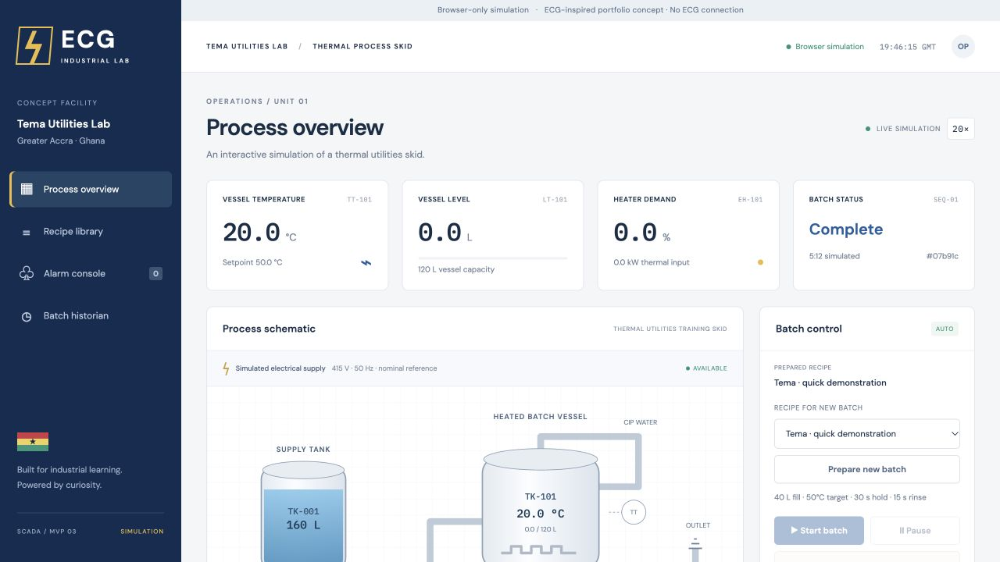

# Tema Utilities Lab · SCADA portfolio

[**Launch the interactive demo →**](https://Ekow244.github.io/tema-utilities-scada/)

A Ghana-inspired industrial automation training project: batch sequencing, PID thermal control, animated tank graphics, recipe management, alarm handling, and batch traceability.

**Independent portfolio simulation.** Tema Utilities Lab is a fictional facility with ECG-inspired styling. It is not affiliated with the Electricity Company of Ghana and uses no real ECG systems or operational data. The process models a water utilities training skid, including a simplified rinse rather than validated CIP.

## Try it

Open the [GitHub Pages demo](https://Ekow244.github.io/tema-utilities-scada/), select a recipe, prepare a batch and start it. Watch fill → heat → hold → discharge → rinse, then inject a sensor or pump fault. Inspect the alarm response, acknowledge it, and review the batch record.

Each visitor runs an isolated simulation in their browser at a nominal 20× speed. Recipes and recent history use local browser storage when available. No sign-in or backend service is required.

## Two execution modes

| | GitHub Pages | Full Docker stack |
|---|---|---|
| Process and controls | JavaScript model with Python-reference parity tests | Python scan-based controller |
| HMI | Same animated SVG process view and trends | Live HTTP polling through a Modbus bridge |
| Communications | In-browser calls; no field protocol | Modbus TCP, Node-RED, MQTT |
| Recipes and history | Browser storage, last 8 batches / 600 samples each | PostgreSQL recipe versions and historian |
| Deployment | Static GitHub Pages | Local Docker Compose |

The hosted demo does **not** connect to Python, PostgreSQL, MQTT, Modbus, ECG, or physical equipment. The repository contains the complete integration implementation. The current process graphic is SVG; WebGL is not implemented.

## Run the full stack

With Docker Desktop running, from this repository:

```sh
docker compose up -d --build
```

Open [the HMI](http://localhost:8080/) and [Node-RED](http://localhost:1880/). Only these localhost ports are published. See [integration setup](docs/PHASE2.md) and [HMI walkthrough](docs/PHASE3.md).

```text
Python process/controller → Modbus TCP → HTTP bridge → Node-RED → MQTT → PostgreSQL
                                      ↕
                                  Browser HMI
```

## Demonstrated controls

- Explicit sequence states with entry actions, completion criteria and timeouts.
- Level permissives, temperature limits, safe output assignment and latched process faults.
- PI tuning with output limits, anti-windup and manual-to-auto tracking.
- Continuous in-tolerance hold qualification, pause/resume and abort behavior.
- Priority-based alarms with acknowledgement, delay/deadband, timed P2 shelving and lifecycle audit.
- Recipe snapshots, UUID batch identifiers, duplicate command suppression and traceable operator actions.
- Transactional historian writes and idempotent MQTT processing in the Docker version.

These illustrate IEC 61131-3 and ISA-18.2 concepts; this is not certified PLC code or a conformance claim.

## Validate

```sh
python3 -m venv .venv
.venv/bin/pip install -r requirements.txt
.venv/bin/python -m unittest discover -s tests -v
node --test tests/demo-engine.test.cjs
```

The two PostgreSQL tests need `DATABASE_URL`; alternatively run them inside the live stack:

```sh
docker compose exec -T historian python - < tests/test_historian.py
python3 verify_hmi.py
```

`verify_hmi.py` needs a fresh IDLE simulator and verifies the full HMI API. [Recorded API check](runs/hmi-verification.json).

The browser model matches the Python baseline: normal batch completion at 990 simulated seconds and a 62.194°C peak for a 60°C setpoint. Tests also compare heat-loss, sensor-fault and pump-fault outcomes.

## Develop or publish the browser demo

```sh
python3 scripts/build_pages.py
python3 -m http.server 8090 --directory pages --bind 127.0.0.1
```

Open http://localhost:8090/. The build uses relative asset paths so project-site hosting works. Pushes to `main` run Python and browser-model tests, build the static assets and deploy using the GitHub Pages workflow. There is no JavaScript dependency installation or bundler.

Browser mode starts a fresh process when the page reloads. Stored unfinished batches are marked interrupted. History is local to the browser and capped; clearing site storage removes it. Background tabs may throttle simulation timing. No hosted SQL durability is claimed.

## Project guide

- [Phase 1: process model and control behavior](docs/PHASE1.md)
- [Phase 2: field communications and SQL historian](docs/PHASE2.md)
- [Phase 3: HMI, alarm philosophy and interview walkthrough](docs/PHASE3.md)


