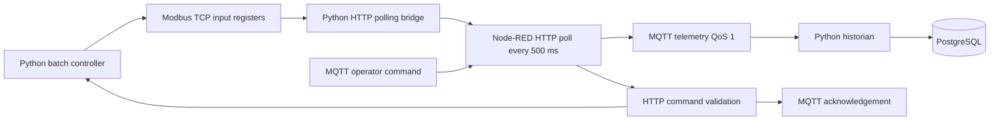

# Phase 2 — live integration and historian

## Start the local demo

Install and start Docker Desktop, then run from the project folder:

```sh
docker compose up -d --build
```

Open Node-RED at http://localhost:1880 to inspect the supplied flow. Its flow file is mounted read-only so the checked-in demo is reproducible. The simulator bridge is at http://localhost:8080/telemetry. This is JSON telemetry, not the future HMI.

Start a batch through MQTT:

```sh
docker compose exec -T mqtt mosquitto_pub -h localhost -q 1 \
  -t scada/v1/commands \
  -m '{"request_id":"demo-start-001","action":"start"}'
```

Watch the live stream or acknowledgements in a second terminal:

```sh
docker compose exec -T mqtt mosquitto_sub -h localhost -v \
  -t scada/v1/telemetry -t scada/v1/acks
```

Use a new request ID for each intended command. Supported actions: `start`, `pause`, `resume`, `abort`, `sensor-fault`, `pump-fault`, `heat-loss`. Fault injection requires an active batch. Duplicate IDs return the original acknowledgement; an ID reused for a different action is rejected. Commands must not be retained. Node-RED rejects retained command deliveries. These controls demonstrate the simulator only.

Direct HTTP is also available for the future HMI:

```sh
curl -X POST http://localhost:8080/commands \
  -H 'Content-Type: application/json' \
  -d '{"request_id":"pause-001","action":"pause"}'
```

Default speed is 20 simulated seconds per real second. A normal batch takes roughly 50 seconds plus scheduling overhead. To change it:

```sh
SIM_SPEED=10 docker compose up -d simulator
```

Each simulator process owns one batch UUID. To get another fresh batch, restart only that service. The historian retains earlier batches:

```sh
docker compose restart simulator
```

Stop services without deleting history:

```sh
docker compose down
```

## Data path



Node-RED triggers each poll through a small Python bridge that makes an actual Modbus TCP read. It does not use a Node-RED Modbus extension. This keeps the flow dependent only on built-in Node-RED nodes. The bridge locks the scan during a read so state metadata and registers form a consistent snapshot. Direct Modbus writes do not control actuators: validated sequence commands own the outputs.

## Modbus register map

Unit ID 1, TCP port 1502 inside the simulator container, function 04 (read input registers). Addresses below are zero-based protocol offsets; conventional labels start at 30001. All values are unsigned 16-bit integers.

| Offset | Tag | Decode |
|---|---|---|
| 0 | Vessel volume | raw / 100 L |
| 1 | Temperature | raw / 100 °C |
| 2 | Setpoint | raw / 100 °C |
| 3 | Heater output | raw / 100 percent |
| 4 | Qualified hold | raw / 10 seconds |
| 5 | Sequence state | Index in `list(State)` below |
| 6 | Temperature quality | 0 good, 1 sensor failure |
| 7 | Inlet valve command | 0 closed, 1 open |
| 8 | Discharge pump command | 0 stopped, 1 running |
| 9 | Rinse valve command | 0 closed, 1 open |

State codes 0–14: IDLE, PRECHECK, FILL, HEAT, HOLD, DISCHARGE, CIP_FILL, CIP_RINSE, CIP_DRAIN, COMPLETE, PAUSED, ABORTING, ABORTED, FAULTED.

Pump command is not proof of flow: an injected pump failure can leave the command running with no discharge. Temperature remains the last simulated numeric value with BAD quality after sensor failure; consumers must check quality. A failed Modbus read returns HTTP 503 and Node-RED suppresses that snapshot. Consumers must use the last timestamp to detect stale telemetry; a retained message alone does not prove the plant is online.

## MQTT contract and SQL

- `scada/v1/telemetry`: schema version 1, QoS 1, retained latest snapshot.
- `scada/v1/commands`: JSON object with `request_id` and `action`, QoS 1, not retained.
- `scada/v1/acks`: accepted/rejected result, request ID, timestamp, simulated time and state; not retained.

Telemetry has batch UUID, monotonically increasing sequence within that process, UTC acquisition timestamp, simulated seconds, state, immutable recipe snapshot, tags with value/units/quality, cumulative state events, and cumulative command audit. Acquisition timestamps are wall time; event `time` values are simulated seconds. Do not compare them directly.

PostgreSQL tables:

| Table | Contents |
|---|---|
| batches | Recipe snapshot, lifecycle timestamps, latest state and sequence |
| samples | One timestamped tag snapshot per received batch/sequence |
| events | Ordered state changes and fault reasons, keyed by batch/event index |
| commands | Accepted and rejected validly shaped commands, keyed by batch/request ID |

Malformed requests are rejected before the controller audit. Operator identity/authentication and a separate alarm lifecycle are deferred to later phases.

Inspect records:

```sh
docker compose exec -T postgres psql -U scada -d scada -c \
  'SELECT batch_id, state, started_at, ended_at, recipe FROM batches;'
docker compose exec -T postgres psql -U scada -d scada -c \
  'SELECT batch_id, event_index, sim_time, state, reason FROM events ORDER BY batch_id,event_index;'
docker compose exec -T postgres psql -U scada -d scada -c \
  "SELECT batch_id, sim_time, tags->'temperature'->>'value' AS temperature FROM samples ORDER BY timestamp DESC LIMIT 10;"
```

Each historian write is transactional. Duplicate deliveries do not duplicate samples, commands or events; older deliveries cannot roll back the batch's latest state. The historian uses a persistent MQTT session and acknowledges QoS 1 messages only after database commit. Database and broker use named volumes.

MVP limits: telemetry is sampled every 500 ms of wall time (about 10 simulated seconds at 20x), not every control scan. Cumulative events and commands recover intermediate transitions while the simulator remains running. There is no durable simulator outbox; restarting it before final history is delivered can lose unsent history. A broker crash can lose data since its last persistence save. This is demo traceability, not a guarantee of lossless industrial recording.

## Verify

The Phase 1 tests require only Python. For the added real-TCP integration tests:

```sh
python3 -m venv .venv
.venv/bin/pip install -r requirements.txt
.venv/bin/python -m unittest discover -s tests -v
```

On a running stack with a fresh IDLE simulator:

```sh
python3 verify_stack.py
```

This runs a normal batch through MQTT with pause/resume and a repeated start command, checks PostgreSQL records, restarts the simulator, and runs a sensor-fault batch. It saves `runs/phase2-verification.json`. It intentionally leaves the second batch FAULTED for inspection; restart the simulator for a new demo.

Test SQL duplicate handling, out-of-order delivery, and atomic rollback against the running database:

```sh
docker compose exec -T historian python - < tests/test_historian.py
```

Those database tests roll back their synthetic records. Nine control/Modbus tests and two live PostgreSQL tests are provided.

## Hosting boundary

Only the bridge and Node-RED editor are published, both on localhost. Modbus, MQTT and PostgreSQL have no host ports. The broker allows anonymous access only on the private Compose network; database credentials are explicit local-demo credentials. This stack is for local demonstration. The public release still needs its web HMI, HTTPS, protected controls, session isolation and a private editor.

Implementation references: [pyModbusTCP 0.3 server API](https://pymodbustcp.readthedocs.io/en/stable/package/class_ModbusServer.html), [Node-RED MQTT recipes](https://cookbook.nodered.org/mqtt/), [Paho client API and acknowledgement behavior](https://eclipse.dev/paho/files/paho.mqtt.python/html/client.html).
