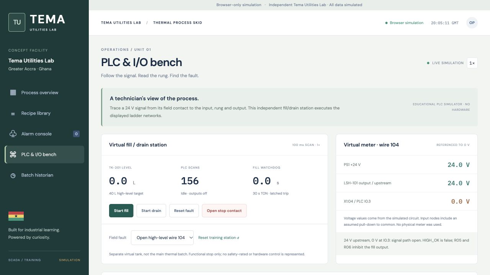

# PLC and I/O technician training package

Open the [public demo](https://ekow244.github.io/tema-utilities-scada/) and choose **PLC & I/O bench**. This is an educational ladder interpreter with a virtual 24 V fill/drain station, not a physical PLC or a vendor-certified runtime. It reimplements the main process's fill and drain functions on a separate tank. Heating, recipe sequencing and the SQL historian remain in the original thermal process.

## What actually executes

[`program.json`](program.json) is the canonical ladder network source. [`plc-engine.js`](../scada/web/plc-engine.js) executes it: input image → networks in order → output assignment → virtual plant update. Memory coils are visible to subsequent networks within a scan. Timer R02 reads the previous scan's FILL_OUT value because its network runs before the output network. Scan interval is 100 ms at nominal real-time 1× speed; browser throttling can slow it. No claim of a real-time guarantee is made.

The interpreter supports true-bit and inverted-bit contacts, series and parallel conditions, OTE ordinary coils, R_TRIG rising-edge blocks and a nonretentive TON. Changing the network definitions changes behavior; a test verifies that adding a false commissioning permissive inhibits the output. This is a deliberately small ladder subset, not a complete implementation of IEC 61131-3 or an importable TIA Portal / Studio 5000 project.

| Network | Function |
|---|---|
| R00 | Fill pushbutton rising edge |
| R01 | Drain pushbutton rising edge |
| R02 | Fill output TON watchdog, 30 seconds |
| R03 | Set-dominant fault latch for timeout/overload |
| R04 | Drain seal-in with stop, overload, low-level and opposing-request checks |
| R05 | Fill seal-in with stop, high-level and opposing-request checks |
| R06 | Interlocked fill relay output |
| R07 | Interlocked drain relay output |
| R08 | Latched fault lamp |

## Engineering artifacts

- [I/O list with addresses, devices, terminals and wire numbers](../scada/web/training/io-list.csv)
- [Ladder drawing generated from the executable networks](../scada/web/training/ladder.svg)
- [24 V DC conceptual wiring drawing](../scada/web/training/wiring.svg)
- [Executed open-wire diagnostic report](../scada/web/training/fault-report.md)
- [Raw diagnostic checkpoint values](evidence/open-wire-diagnosis.json)

The I/O model has seven digital inputs and three digital outputs. Inputs use 24 V dry contacts into a sinking input group with COM at 0 V. Outputs represent sourcing channels driving 24 V interposing relay coils and a lamp. The wiring drawing gives functional connections, not a construction-ready panel design or device selection. No mains circuit is shown; the functional stop is not an emergency-stop safety system.

The physical high-level contact is **NC below 40 L**. Its software HIGH_OK contact tests a **true** bit, without logical negation. Reaching high level or opening its signal conductor makes HIGH_OK false and inhibits fill. LOW_WET is true above 0.1 L and stops drain at empty. Only a fresh start edge can reseal a dropped request after repairing a wire or restoring stop.

## Three-minute interview walkthrough

1. **Normal operation:** reset the station, Start Fill, follow R00/R05/R06, then watch the high-level input open around 40 L. Start Drain and watch LOW_WET drop near empty. Filling and draining each take about 20 seconds at 2 L/s.
2. **Input fault:** reset the station, select Open high-level wire 104 and press Start Fill. Find I0.3 off, HIGH_OK contacts open, and Q0.0 off. Compare the virtual test points: supply and contact output are 24 V, while X1:04 is 0 V. Explain the missing permissive before considering a replacement output device.
3. **Recovery:** select Healthy field wiring. Verify the input returns without automatic restart. Press Start Fill again and verify controlled filling resumes.
4. **Actuator fault:** reset the station, select Inlet valve stuck closed and Start Fill. Q0.0 energizes but level does not rise. After 30 seconds, TON latches FAULT and removes the output. Restore the field condition, Reset Fault, then use a fresh Start.
5. **Explain the distinction:** a wiring input fault prevents the fill request from sealing; a stuck valve produces a valid output command with no process response, then times out.

The meter panel shows model-generated nodes, not evidence of real electrical measurements. A 0 V high-level input at a full vessel is normal, while a 24 V upstream / 0 V downstream split below the target identifies the injected open path. The exercise assumes an input pull-down; a real floating conductor or faulty input could behave differently.

## Reproduce the evidence

```sh
node --test tests/*.test.cjs
node plc/diagnose-wire.cjs
node scripts/build_plc_docs.cjs
python3 scripts/build_pages.py
```

The diagnostic script asserts the fault symptom, virtual voltage split, no automatic restart, restored filling, high-level stop and low-level drain stop. It writes the raw result into `plc/evidence/`. The documentation generator reruns the same diagnostic logic and produces the downloadable report, CSV and drawings. GitHub Actions runs the tests and regenerates these files before deployment.

## Honest résumé language

“Implemented a simulated ladder-logic fill/drain station with digital I/O mapping, seal-in control, level permissives and a TON watchdog; diagnosed an injected open input conductor using virtual voltage checks and rung-state monitoring.”

Do not describe this as physical panel wiring, commissioning, Siemens/Allen-Bradley experience or utility-company work. A hardware or vendor-simulator exercise would be a distinct next step.

## References

- [PLCopen: IEC 61131-3 overview](https://www.plcopen.org/standards/logic/iec-61131-3/) for Ladder Diagram context.
- [AutomationDirect CLICK installation and wiring](https://cdn.automationdirect.com/static/manuals/c0userm/ch3.pdf) for DC input/output and sourcing/sinking concepts. The conceptual trainer is not assigned to a particular CLICK CPU or module.


